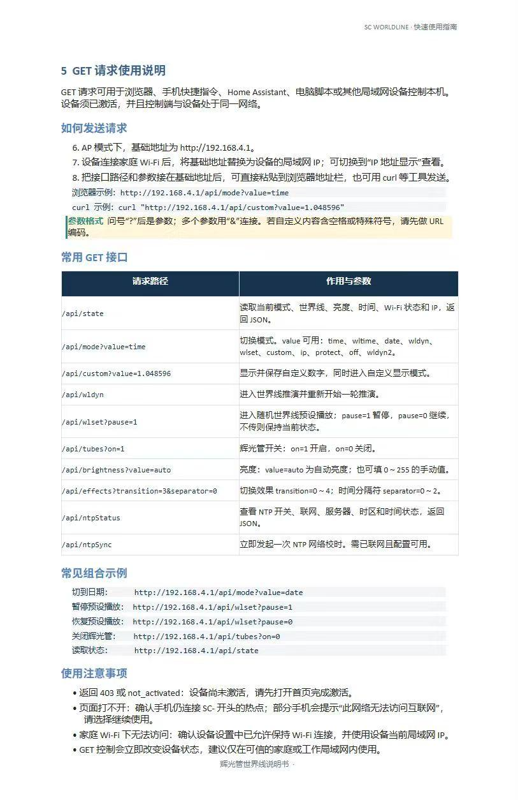
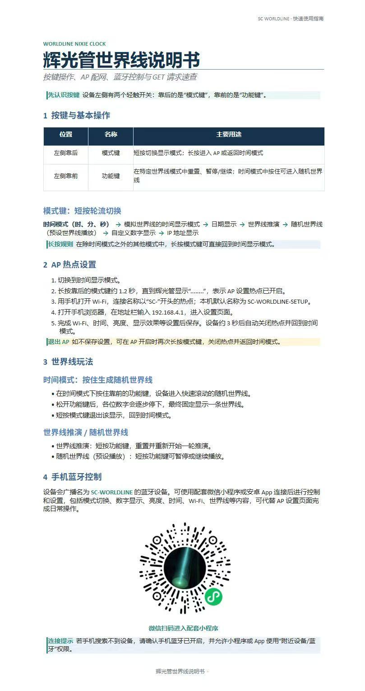

# NIXIE Control

**Divergence Meter（世界线变动率探测仪）的 Android 蓝牙控制端**

基于 Kotlin + Jetpack Compose，通过 BLE 控制 ESP32 主控的辉光管世界线探测仪。界面为日文。

| 扫描与连接 | 控制界面 |
|---|---|
|  |  |

---

## 简介

设备本体是一台 8 位辉光管时钟，外观与显示逻辑取自《STEINS;GATE》的世界线变动率探测仪。设备用两个轻触开关即可完成全部操作，本 App 提供的是一块「遥控器」：把开关操作、显示内容、亮度、时间与网络配置都搬到手机上，省去长按短按的记忆负担，也方便做精确设置。

App 不依赖云端，不做任何统计上报，所有指令直接通过蓝牙写入设备。

---

## 功能特性

| 功能 | 说明 |
|---|---|
| 设备扫描与连接 | 按 BLE 名称识别设备（`SC-WORLDLINE`），列表显示信号强度 |
| 世界线显示 | 实时读取并显示设备当前世界线变动率，如 `1.048596` |
| 推演控制 | 「推論を開始 / ロックを停止」启动或锁定推演 |
| 模式切换 | 世界线模式 / 时钟模式 |
| 辉光管开关 | 一键点亮或熄灭全部辉光管 |
| 数字循环 | 执行一轮全位数字循环，用于防止阴极中毒 |
| 时间同步 | 把手机当前时间写入设备 |
| 亮度调节 | 自动亮度，或手动 10%～100%（对应设备端 26～255）|
| 自定义显示 | 发送任意数字组合并保存为设备预设 |
| 显示效果 | 12/24 小时制、过渡效果（5 档）、分隔符效果（3 档）|
| 自动电源 | 设定每日开机与关机时刻 |
| 网络与 NTP | 配置 WiFi SSID / 密码、NTP 服务器、时区 |

---

## 设备端显示模式

设备本体由按键循环切换 7 个模式，App 可切换其中大部分：

| # | 模式 | 显示内容 |
|---|---|---|
| 1 | 时间 | 当前时间 |
| 2 | 模拟世界线 | `1.xxxxxx`，后 6 位为时分秒 |
| 3 | 日期 | 6 位日期数字 |
| 4 | 随机世界线 | `x.xxxxxx`，进入即随机（0～3.999999）|
| 5 | 世界线推演 | 数值持续变动 |
| 6 | 预设值 | 之前保存的自定义内容 |
| 7 | IP 地址 | 设备局域网 IP |

> 设备另有局域网 HTTP 接口（`/api/state`、`/api/mode?value=` 等），可用电脑直接控制，不必经过手机。

---

## 通信协议

使用 Nordic UART Service（NUS）风格的自定义 GATT 服务：

| 用途 | UUID |
|---|---|
| 服务 | `6e400001-b5a3-f393-e0a9-e50e24dcca9e` |
| 写入（RX）| `6e400002-b5a3-f393-e0a9-e50e24dcca9e` |
| 通知（TX）| `6e400003-b5a3-f393-e0a9-e50e24dcca9e` |

### 报文格式

指令为**单行 JSON，以换行符 `\n` 结尾**，按 20 字节分片写入（未协商 MTU，沿用 ATT 默认 23）。设备返回的也是同样格式的 JSON 行。

### 指令一览

| 指令 | 载荷示例 | 作用 |
|---|---|---|
| `worldline2_start` | `{"cmd":"worldline2_start"}` | 开始推演 |
| `worldline2_stop` | `{"cmd":"worldline2_stop"}` | 停止推演 |
| `set_mode` | `{"cmd":"set_mode","data":{"mode":"time"}}` | 切换模式（`worldline` / `time` / `cathode` / `custom`）|
| `tube_power` | `{"cmd":"tube_power","data":{"on":true}}` | 辉光管电源 |
| `set_brightness` | `{"cmd":"set_brightness","data":{"mode":"manual","value":178}}` | 亮度（`auto` / `manual`，0～255）|
| `sync_time` | `{"cmd":"sync_time","data":{"timestamp":1761904800}}` | 时间同步（**秒级 UTC 时间戳**，不含时区）|
| `set_custom` | `{"cmd":"set_custom","data":{"digits":"1.048596"}}` | 自定义显示 |
| `get_config` | `{"cmd":"get_config"}` | 读取配置 |
| `set_config` | `{"cmd":"set_config","data":{...}}` | 写入配置（时区、NTP、自动电源、显示效果等）|

> `sync_time` 只发送时间戳，设备的本地时间由「时间戳 + 设备自身配置的时区（分钟）」决定。
> 因此时区需单独设置：日本 `540`，中国 `480`（默认值）。

---

## 技术栈

| 项目 | 版本 |
|---|---|
| 语言 | Kotlin 2.0.21 |
| UI | Jetpack Compose + Material 3 |
| 构建 | Gradle 8.13 / AGP 8.13.2 |
| JDK | 17 |
| minSdk | 26（Android 8.0）|
| targetSdk / compileSdk | 36 |

---

## 构建

### 前置条件

- JDK 17
- Android SDK（含 Platform 36 与 Build-Tools）

### 步骤

```bash
git clone https://github.com/KurogawaSaame/divergence_meter_app.git
cd divergence_meter_app
```

在项目根目录创建 `local.properties`，写入本机 SDK 路径：

```properties
sdk.dir=C\:\\Android\\Sdk
```

然后构建：

```bash
./gradlew assembleDebug
```

产物：`app/build/outputs/apk/debug/app-debug.apk`

> `local.properties` 含本机路径，已被 `.gitignore` 排除，不会提交。
> 若项目位于含中文等非 ASCII 字符的目录下，`gradle.properties` 中的
> `android.overridePathCheck=true` 用于跳过 AGP 的路径检查。

---

## 使用

1. 打开设备，确认蓝牙已开启
2. 在 App 中点击「実験装置をスキャン」开始扫描
3. 在列表中点击 **`SC-WORLDLINE`** 连接（其余「不明なデバイス」为周围其他蓝牙设备）
4. 连接成功后可切换「制御」页做日常操作，或切「設定」页修改显示、电源、网络配置

Android 12 及以上需授予「附近设备」权限；部分机型扫描 BLE 还需「位置信息」权限。

---

## 项目结构

```
.
├── app/
│   ├── build.gradle.kts
│   └── src/main/
│       ├── AndroidManifest.xml
│       ├── java/com/zhushui/nixiecontrol/
│       │   ├── MainActivity.kt        # Compose 界面与页面逻辑
│       │   ├── BleManager.kt          # BLE 连接、指令收发、状态流
│       │   └── ui/theme/              # 配色与排版
│       └── res/
│           ├── values/strings.xml     # 界面文案（日文）
│           └── mipmap-*/              # 应用图标
├── docs/screenshots/                  # README 截图
├── gradle/libs.versions.toml          # 依赖版本清单
├── 日文化改造说明.md                    # 界面日文化的改造记录
└── README.md
```

---

## 常见问题

**搜索不到设备**
确认手机蓝牙已开启，并授予「附近设备 / 蓝牙」权限；Android 12+ 部分机型还需要「位置信息」权限。

**连上了但按钮没反应**
设备可能处于辉光管关闭状态，先点「ニキシー管を点灯」。

**时间同步后显示的时刻不对**
检查「設定 → ネットワークと NTP」里的时区是否正确（日本为 `540`）。App 只发送 UTC 时间戳，本地时刻由设备按该时区换算。

**数字变化有拖影 / 不够干脆**
把过渡效果从默认的「フェードイン・アウト（淡入淡出）」改为「即時切り替え（直接切换）」。

**修改设置后不生效**
设置页的改动需点击「設定を保存」才会写入设备。

---

## 相关文档

- [日文化改造说明.md](日文化改造说明.md) — 界面从中文改为日文的完整改造记录

---

## 许可证

本项目暂未声明开源许可证。如需在他人项目中使用，请先联系作者。

## 致谢

- 设备硬件与固件协议由原作者提供
- 世界线变动率探测仪的设计源自《STEINS;GATE》
